

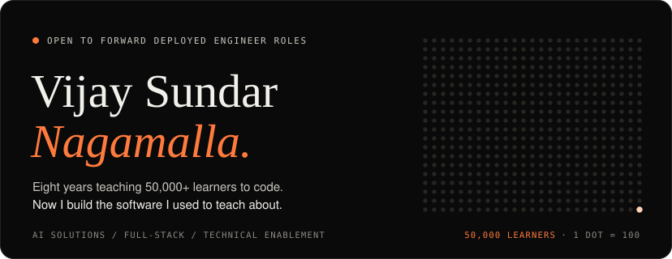

 

<picture>
  <source media="(prefers-color-scheme: dark)" srcset="assets/ch-01-dark.svg" />
  
</picture>

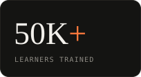
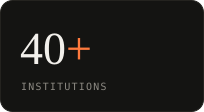
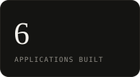
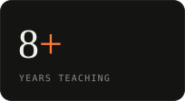

I spent eight years in classrooms across 40+ institutions, teaching C, Java, Python, SQL and DSA to more than 50,000 learners. Somewhere along the way I stopped only explaining how software gets built and started building it: classroom analytics, an academic platform, a RAG-powered loan copilot, and AI tools that run entirely on your own machine.

That mix is what I bring to **Forward Deployed Engineering**: I can sit with the people who will use a system, work out what they need, build it, and then teach them to run it.

 

<picture>
  <source media="(prefers-color-scheme: dark)" srcset="assets/ch-02-dark.svg" />
  
</picture>

<a href="https://github.com/myviapps/PropIQ-CRE-Loan-Intelligence">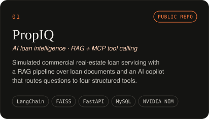</a>
<a href="https://vukti.in">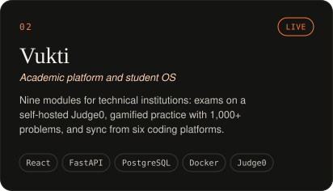</a>
<a href="https://almaanac.vercel.app/">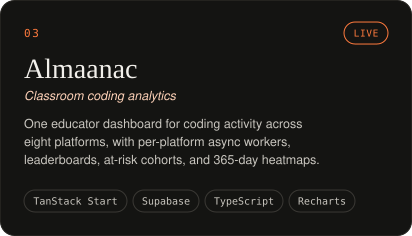</a>
<a href="https://myviapps.github.io/fde-flow-atlas">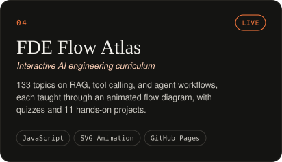</a>
<a href="https://github.com/myviapps/I-L-F-U">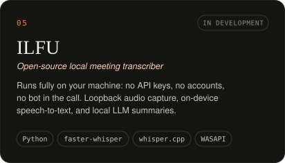</a>
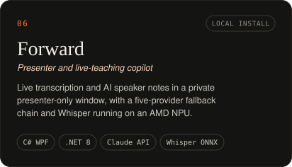

Project details as text

 

| Project | What it is | Stack |
|---|---|---|
| [PropIQ](https://github.com/myviapps/PropIQ-CRE-Loan-Intelligence) | Simulated commercial real-estate loan servicing with a RAG pipeline over loan documents, an AI copilot that routes questions to four structured MCP tools, PDF field extraction, and risk scoring. | React, Node.js / Express, MySQL, FastAPI, LangChain, NVIDIA NIM, FAISS |
| [Vukti](https://vukti.in) | Nine-module academic platform: exams (MCQ, coding, SQL) on a self-hosted Judge0, gamified practice with 1,000+ problems, and sync from six coding platforms. Used with my own training batches. | React, FastAPI, PostgreSQL, Redis, Docker, Judge0 |
| [Almaanac](https://almaanac.vercel.app/) | One educator dashboard for coding activity across eight platforms, with per-platform async workers, leaderboards, at-risk cohorts, and 365-day heatmaps. Used with my own training batches. | TanStack Start, Supabase, TypeScript, Recharts |
| [FDE Flow Atlas](https://myviapps.github.io/fde-flow-atlas) | 133-topic interactive curriculum on RAG, tool calling, and agent workflows, taught through animated flow diagrams, quizzes, and 11 hands-on projects. | HTML, CSS, JavaScript, SVG |
| [ILFU](https://github.com/myviapps/I-L-F-U) | Open-source meeting transcriber that runs fully on your machine: no API keys, no accounts, no bot in the call. In development. | Python, faster-whisper, whisper.cpp, WASAPI |
| Forward | Windows copilot giving presenters live transcription and AI speaker notes in a private window, with a five-provider fallback chain and on-device Whisper. | C# WPF, .NET 8, Claude API, Whisper ONNX |

 

<picture>
  <source media="(prefers-color-scheme: dark)" srcset="assets/ch-03-dark.svg" />
  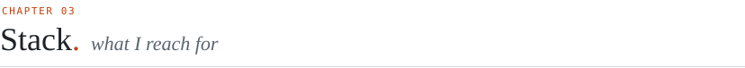
</picture>

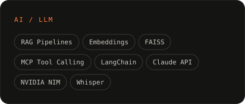
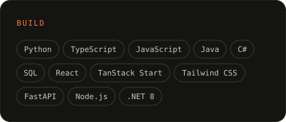
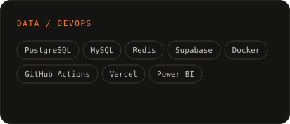
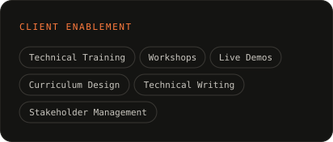

 

<picture>
  <source media="(prefers-color-scheme: dark)" srcset="assets/ch-04-dark.svg" />
  
</picture>

B.Tech, Electronics and Communication Engineering · North East Christian University · 2019

